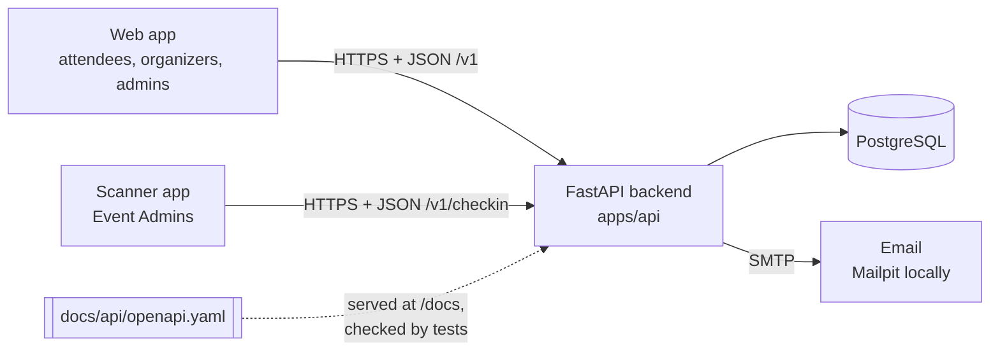
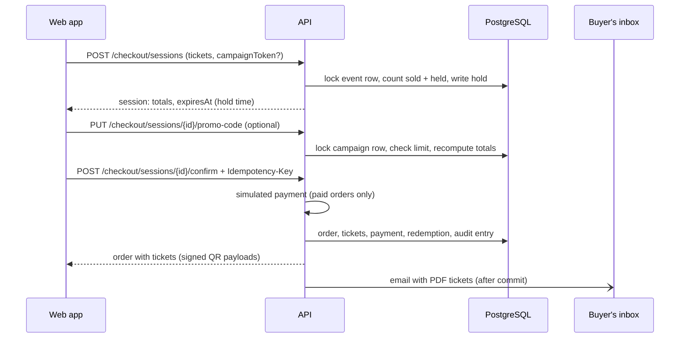

# Architecture

One backend, one database, no microservices (SRS §9). Web and mobile talk only to the API.

## Web, scanner, and deployment

`apps/web` is a React/Vite/TypeScript single-page app with plain CSS. Each feature has one
screen module; shared forms, lists, requests, and translations stay in small utility files.
The browser uses relative `/v1` URLs, proxied by Vite during editing and Caddy in Docker.

`apps/mobile` retains the Expo SDK 57 staff app merged into main. Its screens, API calls,
session handling, and scanning/search workflows are separate modules with Jest tests. It is
online-only; tokens use SecureStore, while ticket results remain in memory. The web session
lasts for the browser tab.

The web uses generated OpenAPI types; mobile validates API responses through its existing
typed decoders. Business logic stays in the backend.
`compose.server.yml` provides the standalone HTTPS server stack; see [deployment](deployment.md).

## Backend layout

| Folder / file | Job |
| --- | --- |
| `app/routers/` | HTTP endpoints, one file per contract area. Thin: check access, call a service, commit. |
| `app/services/` | The rules: event status and activation, inventory, seating, pricing and promos, checkout, payments, refunds, PDFs, QR codes, email, analytics, audit log. |
| `app/services/messages.py` | Every email and PDF text in Kazakh, Russian, and English. |
| `app/models.py` | ORM tables, mirroring `db/schema.sql`. |
| `app/schemas.py` | Request and response bodies, shaped like the contract (camelCase JSON). |
| `app/views.py` | Turns rows into response bodies. |
| `app/deps.py`, `security.py`, `errors.py` | Sign-in, roles, paging, tokens, the one error format. |

## How a purchase works

- **Holds are atomic.** Counting and holding happen under a row lock, so two buyers never get
  the same last ticket. Holds expire on their own: expired sessions simply stop counting.
- **Nothing is issued before payment.** A declined payment is recorded and emailed, and the
  buyer can retry while the hold lasts. The same Idempotency-Key never creates a second order.
- **Discounts come from the server.** The client sends a code or a campaign token, never an amount.

## How a scan works

The ticket QR holds `BFT1.<ticket id>.<signature>`. The signature (HMAC with `QR_SECRET`)
makes tickets impossible to forge, and because the PDF and the app show the same payload,
paper and phone are one ticket. A Campaign QR holds a web link with an opaque token; the
scanner recognises it and answers `rejected_campaign_qr`. Check-in locks the ticket row and a
unique index allows one active check-in, so two scanners can't admit the same ticket.

## Assigned seating (bonus)

A seated event points to a predefined layout (`GET /venues`). Buyers pick seats on
`GET /events/{id}/seats` and send `seatIds` to checkout instead of `items`. The same event-row
lock that protects ticket counts also protects seats, the hold is a `seat_holds` row that stops
counting when the checkout expires, and a unique index stops a second valid ticket for a seat.

## Offline scanning (bonus)

The backend supports `/checkin/events/{id}/offline-list` and `/offline-sync` for future
clients. The current staff app deliberately remains online-only. A future offline client
would download the list before the doors open and synchronize locally recorded scans later. The first check-in
that reaches the server wins; later ones for the same ticket come back as `already_used`.

## Cross-cutting choices

- **Contract first.** `/docs` shows `docs/api/openapi.yaml`, not a spec generated from code, and
  every test response is validated against it.
- **Emails after commit.** Notifications are stored in the same transaction and sent only when
  it commits, so a failed action never emails anyone.
- **Audit log.** Important actions go to `audit_log`, which is append-only (database trigger).
  It powers the event timeline (§4.16).
- **Settings in the database.** Fees, hold time, and guest checkout are admin-editable rows,
  not environment variables.
- **Languages.** Emails and PDF tickets use the recipient's language (`kk`, `ru`, `en`). API
  error messages stay English; apps translate by error code (`docs/api/error-codes.md`).

## Why FastAPI and PostgreSQL (SRS §9)

- **Development speed:** FastAPI validates requests from type hints and serves interactive
  docs, so endpoints stay short. Python is quick to read for reviewers from the web and
  mobile side too.
- **Data model:** tickets, orders, payments, and check-ins are relational and must stay
  consistent. PostgreSQL gives foreign keys, CHECK constraints, row locks for atomic holds,
  and partial unique indexes for "one active check-in per ticket".
- **Deployment:** API, database, and Caddy web containers; development adds a mail catcher.
  Start them with `docker compose up --build`.
