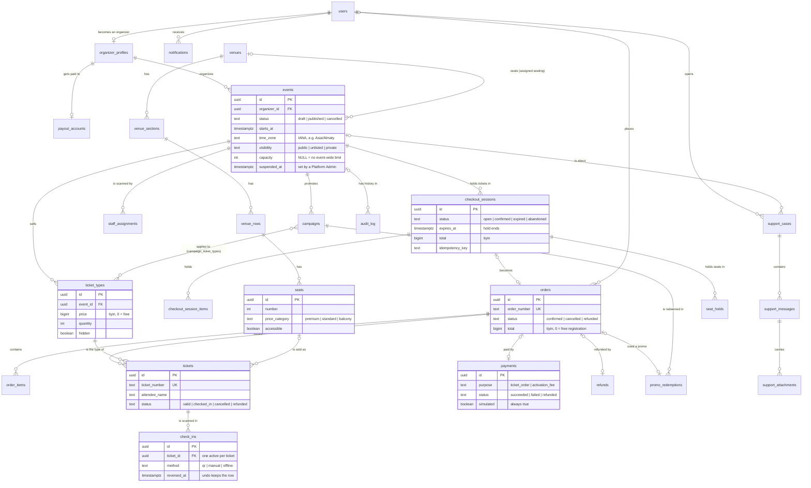

# Database

PostgreSQL 16. The schema is one readable file: [`apps/api/db/schema.sql`](../apps/api/db/schema.sql).
It is the source of truth; `apps/api/app/models.py` mirrors it, and a test fails if they differ.

## Conventions

- UUID keys, `snake_case`, `TIMESTAMPTZ` for every point in time.
- Money is `BIGINT` tiyin (1 KZT = 100). Never a float.
- History is never deleted: orders, tickets, payments, and check-ins change status instead.
- Counts such as "sold" or "held" are not stored; they are counted from `tickets` and open
  `checkout_sessions`, so they can never go out of sync.

## Diagram

Not drawn: `auth_sessions` and `user_tokens` (sign-in and email links), `platform_settings`
(one row of admin-editable settings), `event_blocked_seats`, `event_reports`, and `schema_info`.

## Tables by area

| Area (SRS) | Tables |
| --- | --- |
| Accounts §4.1 | `users`, `auth_sessions`, `user_tokens`, `organizer_profiles`, `payout_accounts` |
| Events §4.2, §4.5 | `events` (activation steps live here and in `payments`), `staff_assignments`, `event_reports` |
| Tickets and promos §4.3, §4.14 | `ticket_types`, `campaigns`, `campaign_ticket_types`, `promo_redemptions` |
| Assigned seating §4.3.1 | `venues`, `venue_sections`, `venue_rows`, `seats` (one predefined layout), `event_blocked_seats`, `seat_holds` |
| Checkout and orders §4.4, §4.6, §4.9 | `checkout_sessions`, `checkout_session_items`, `orders`, `order_items`, `tickets`, `payments`, `refunds` |
| Check-in §4.8 | `check_ins` |
| Support §4.13 | `support_cases`, `support_messages`, `support_attachments` |
| Notifications and history §4.10, §4.16 | `notifications`, `audit_log` |
| Administration §4.12 | `platform_settings` |

The attendee (SRS §6) is stored on each ticket: name, email, phone. A promo code (§6) is part
of its campaign (one code per campaign). `users.language`, `checkout_sessions.language`, and
`orders.language` (`kk`, `ru`, `en`) choose the language of emails and PDF tickets.

The predefined layout ("BiletFlow Hall", 160 seats: Parterre rows A-H, Balcony rows A-D, three
price categories, four wheelchair-accessible seats) is inserted by `schema.sql` itself, so every
database has it. An event uses it by setting `events.venue_id`; each price category is sold by one
ticket type (`ticket_types.seat_category`).

## Guarantees the database enforces

- **No double entry:** a unique index allows only one active check-in per ticket.
- **No seat sold twice:** a unique index allows one valid ticket per seat and event.
- **One price per seat:** a unique index allows one ticket type per seat category and event.
- **One activation fee per event:** a unique index on successful fee payments.
- **Payments are simulated:** `CHECK (simulated)` on `payments` and `refunds`.
- **History can't be rewritten:** a trigger rejects `UPDATE` and `DELETE` on `audit_log`.
- **No overselling:** checkout locks the event row while it counts and writes the hold.
- **Backups:** `scripts/backup.sh` and `scripts/restore.sh`, see `docs/operations.md`.

## Changing the schema

A change goes in two places, because a database can be built two ways:

- **`db/schema.sql`** builds a new database. It stays the current, readable picture of the
  schema.
- **`db/migrations/`** brings an existing database up to date, so nobody loses their local
  data when they pull your change.

Steps:

1. Edit `apps/api/db/schema.sql` and the matching model in `apps/api/app/models.py`.
2. Add `apps/api/db/migrations/<next number>_<what it does>.sql` with the same change
   written as an alteration, for example `ALTER TABLE users ADD COLUMN phone TEXT;`.
3. Run the tests. `tests/test_schema.py` catches a model that no longer matches, and
   `tests/test_migrations.py` builds a database each way and fails if the two disagree.
4. Restart the API (`docker compose up`). Your database is migrated in place; no reset.

Rules:

- **A merged migration is never edited.** Other databases have already run it, so editing
  it changes nothing for them. Correct a mistake with a new migration.
- **Each migration is applied in its own transaction**, so one that fails leaves the
  database as it was instead of half changed.
- **`db/baseline.sql` is frozen.** It is `schema.sql` as it stood when migrations were
  introduced, and it is where the migration chain starts. Never edit it.

A database older than `baseline.sql` cannot be migrated; the API says so and prints the
reset command.

The startup check recognizes the published pre-migration schema even though the frozen
baseline added a comment header. LF/CRLF differences do not require resetting a database.
Unknown older schemas still stop for manual review.
